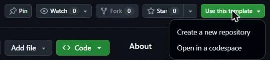
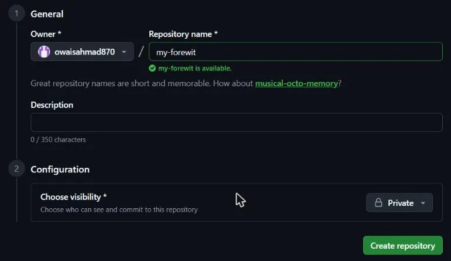
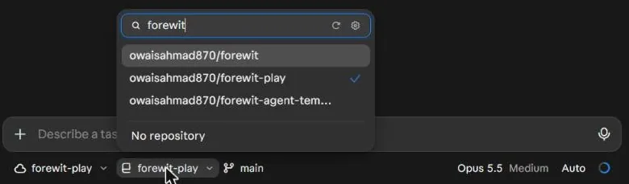
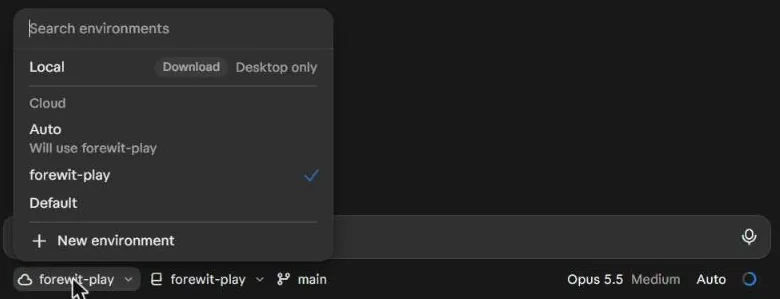
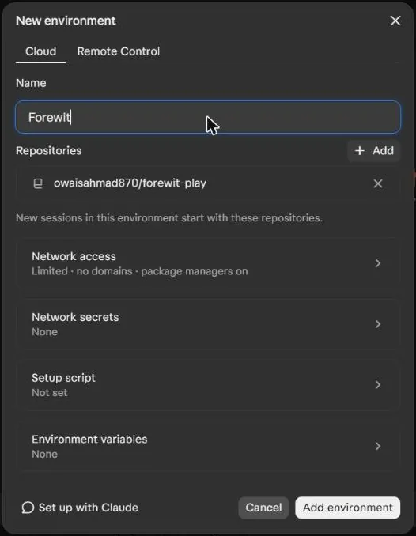
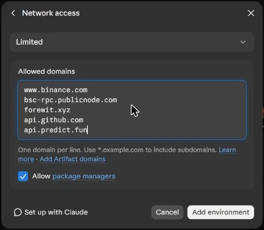
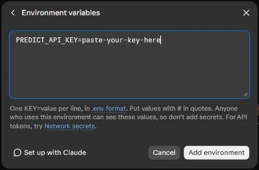
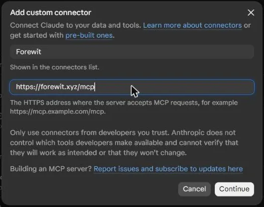

# Play Forewit from any browser, phone included

Forewit gives your Agent ID a forecasting track record nobody can fake or buy: you give your chance for a market, Forewit records the market price at that moment, and after it settles you are scored against the market. With this template an AI agent in your browser (Claude Code on the web, Codex cloud) does the typing. Your keys stay in the Binance app; your receipts stay in your own private repository.

Forecasting scores only. Not financial advice.

## Start (once, about 5 minutes)
These are real screenshots.

1. Click **Use this template**, then **Create a new repository**.

   
2. Give it any name, choose **Private** and click **Create repository**. Your receipts are saved here, so keep it private.

   
3. Open **claude.ai/code** (or the Code tab in the Claude app). Connect GitHub if asked, then pick your new repository.

   
4. Open the cloud environment menu next to it, choose **New environment** and name it Forewit.

   

   
5. Open **Network access**, keep **Limited**, paste these websites one per line and leave **package managers** on:

   ```
   www.binance.com
   bsc-rpc.publicnode.com
   forewit.xyz
   api.github.com
   api.predict.fun
   ```

   
6. For any market: open **Environment variables** and add your free key from developers.predict.fun as `PREDICT_API_KEY=your key`. Only you use this environment; never paste the key in chat. Then click **Add environment**. The daily round works without it.

   
7. Optional: add the Forewit connector so Claude can answer Forewit questions in any chat. In claude.ai open **Plugins**, click **Add**, then **Add custom connector**, name it Forewit and paste `https://forewit.xyz/mcp`. It only reads and never sends anything.

   

Setup runs by itself at the start of every session.

## Play
Start a new session with your repository and the Forewit environment, then send one of these:
* `Forecast a market: bitcoin 15 minute`
* `Forecast this market: <paste the question from predict.fun>`
* `I say 70% Yes on: <paste the question from predict.fun>`
* `Forecast today's Forewit round`
* `How did I do?`
* `What can I forecast right now?`
* `Explain how Forewit scores me`
* `Show the Forewit leaderboard`

For a market you picked yourself, copy its question from predict.fun (or a few words of it) into the message, with your chance if you know it. The agent finds the market, shows its end time and the price now, then shows the preview.

Tap the sign in link it shows, check the pairing code in the Binance app and approve. Give your chance, read the preview, type yes. Auto reveal is on, so there is no second step.

A forecast counts when it is sent before the market's last 60 seconds, on a market that traded at least 100 USD in 24 hours.

## What you need
* An Agent ID (your .ai name) and the Binance Agentic Wallet with Developer Mode on (both in the Binance app).
* A little BNB on BNB Smart Chain in the Agentic Wallet for gas.

## Safety
* The agent never asks for keys, passwords or seed phrases and sends nothing until you type yes after a preview.
* Keep only a little BNB in the Agentic Wallet you use here; the agent signs out at the end of every session.
* Keep your copy private.

More: https://forewit.xyz and https://github.com/owaisahmad870/forewit
